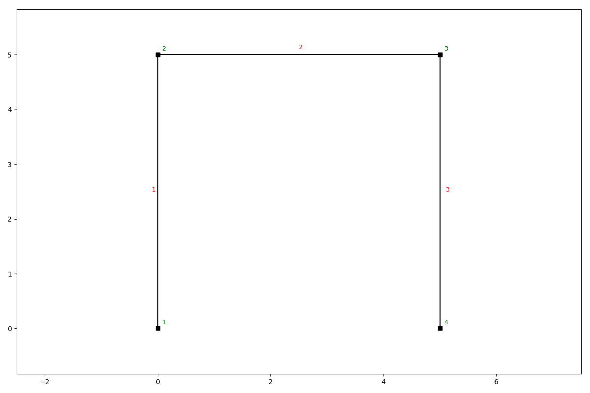
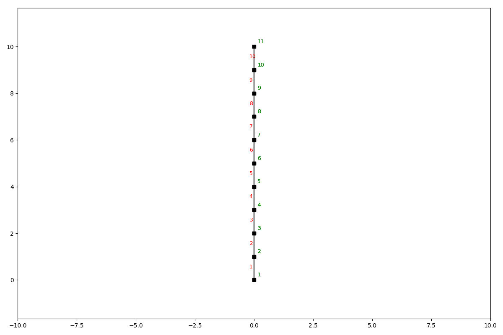
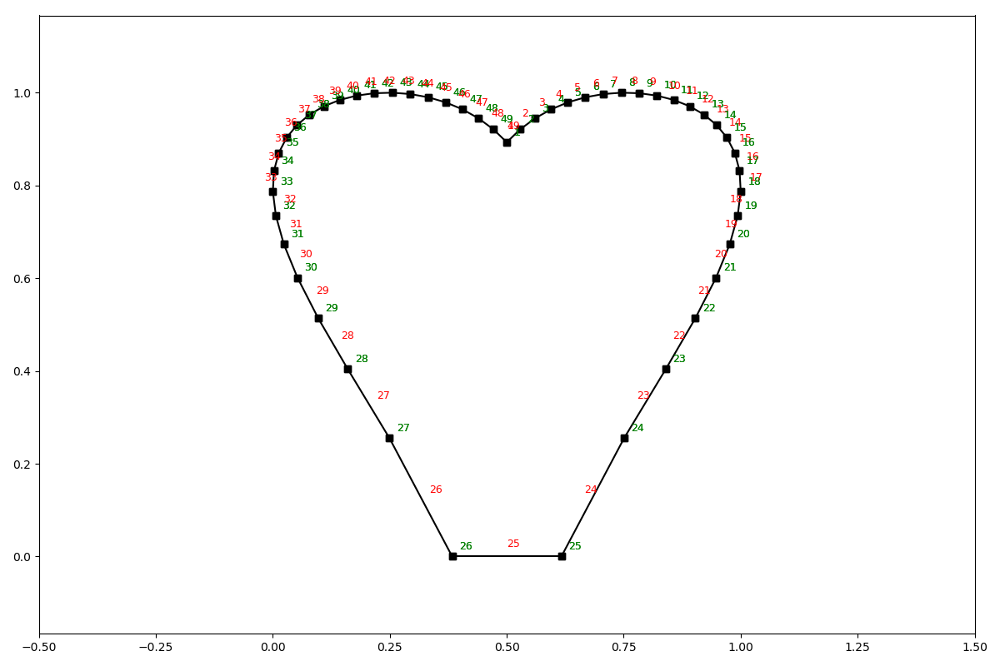

Elements
========

The :code:`SystemElements` class has several methods that help you model a structure. These methods are;

.. code-block:: python

    add_truss_element
    add_element
    add_multiple_elements
    discretize

A structure is defined by elements, which have their own state.

The elements are stored in :code:`SystemElement.element_map`. This is a dictionary with keys representing the element ids, and values being the element objects. The element objects are implicitly created by the :code:`SystemElements` object.

The state of an element can be interesting when post-processing results. For now we'll focus on the modelling part. Below you see the different methods for modelling a structure.

Standard elements
-----------------

Standard elements have bending and axial stiffness and therefore will implement shear force, bending moment, axial force, extension, and deflection. Standard elements can be added with the following methods.

Add a single element
####################

.. automethod:: anastruct.fem.system.SystemElements.add_element

Example
.......

.. code-block:: python

    ss = SystemElements(EA=15000, EI=5000)
    ss.add_element(location=[[0, 0], [0, 5]])
    ss.add_element(location=[[0, 5], [5, 5]])
    ss.add_element(location=[[5, 5], [5, 0]])
    ss.show_structure()

Add multiple elements
#####################

.. automethod:: anastruct.fem.system.SystemElements.add_multiple_elements

Example add_multiple_elements
.............................

.. code-block:: python

    ss = SystemElements(EI=5e3, EA=1e5)
    ss.add_multiple_elements([[0, 0], [0, 10]], 10)
    ss.show_structure()

.. automethod:: anastruct.fem.system.SystemElements.add_element_grid

Example add_element_grid
........................

.. code-block:: python

    from anastruct import SystemElements
    import numpy as np

    # <3
    t = np.linspace(-1, 1)
    x = np.sin(t) * np.cos(t) * np.log(np.abs(t))
    y = np.abs(t)**0.3 * np.cos(t)**0.5 + 1
    # Scaling to positive interval
    x = (x - x.min()) / (x - x.min()).max()
    y = (y - y.min()) / (y - y.min()).max()

    ss = SystemElements()
    ss.add_element_grid(x, y)
    ss.show_structure()

Truss elements
--------------

Truss elements don't have bending stiffness and will therefore not implement shear force, bending moment and deflection.
It does model axial force and extension.

add_truss_element
#################

.. automethod:: anastruct.fem.system.SystemElements.add_truss_element

.. _end-releases:

End releases: hinges and rotational springs
-------------------------------------------

The ends of a standard element can be released with the :code:`spring` argument of :code:`add_element`,
:code:`add_multiple_elements` and :code:`add_element_grid`. The keys are the element nodes (1 and 2), the values the
rotational stiffness :code:`k` of the connection (moment per radian).

* :code:`k = 0` is a hinge. The end carries no bending moment. An element with one hinge has the rotational stiffness
  :math:`3EI/l` instead of :math:`4EI/l`; the rotation of the hinge is eliminated by static condensation.
* :code:`k > 0` is a rotational spring in series with the element: the flexibilities add,
  :math:`C = C_{element} + \mathrm{diag}(1/k_1, 1/k_2)`. A very large :code:`k` approaches a rigid connection.
* A node is an internal hinge when it is declared with :code:`add_internal_hinge`, or when every element that meets in
  the node has a hinge there (:code:`{1: 0}` or :code:`{2: 0}`). All the elements are then released at the node. If one
  or more elements are rigidly connected, they share the rotation of the node, which is solved like any other degree of
  freedom (a moment load or a rotational support at the node is carried by the rigid elements); only the elements with
  a hinge are released, through their own springs. The result does not depend on the order in which the elements were
  added, and the :code:`spring` dictionaries given by the user are never modified.

.. code-block:: python

    ss = SystemElements(EA=1e9, EI=1e4)
    # fixed at node 1, hinge at the end of the element: M = q * L**2 / 8
    ss.add_element([[0, 0], [6, 0]], spring={2: 0})
    ss.add_support_fixed(1)
    ss.add_support_hinged(2)
    ss.q_load(-10, 1)
    ss.solve()

    # end spring of 50 kNm/rad: tip deflection = P * L**3 / (3 * EI) + P * L**2 / k
    ss = SystemElements(EA=1e9, EI=1e4)
    ss.add_element([[0, 0], [4, 0]], spring={1: 50})
    ss.add_support_fixed(1)
    ss.point_load(2, Fy=-10)
    ss.solve()

Mechanical loads, thermal loads and imposed displacements all use the same condensed stiffness, so releases are exact
for each of them.

Discretization
--------------

You can discretize an element in multiple smaller elements with the discretize method. The supports, loads, imposed
displacements and internal hinges are carried over. Hinges, rotational springs and plastic moments stay at the ends of
the original element. Truss elements are not divided, because the nodes between collinear truss elements would be
mechanisms. Note that the ids of the nodes and elements of the new mesh differ from the original ones; use
:code:`find_node_id` to find a node by its location.

.. automethod:: anastruct.fem.system.SystemElements.discretize

Insert node
-----------

Most of the nodes are defined when creating an element by passing the vertices (x, y coordinates) as the location
parameter. It is also to add a node to elements that already exist via the insert_node method.

.. automethod:: anastruct.fem.system.SystemElements.insert_node