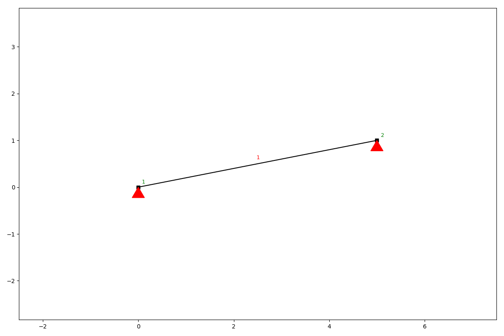
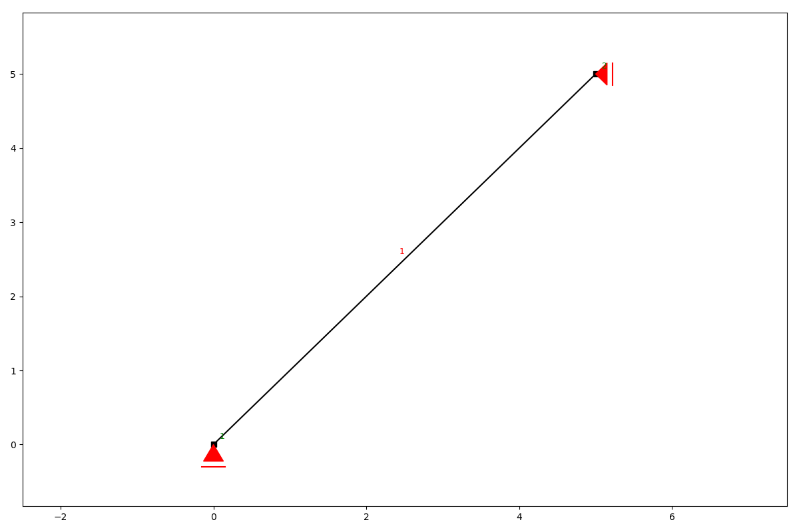
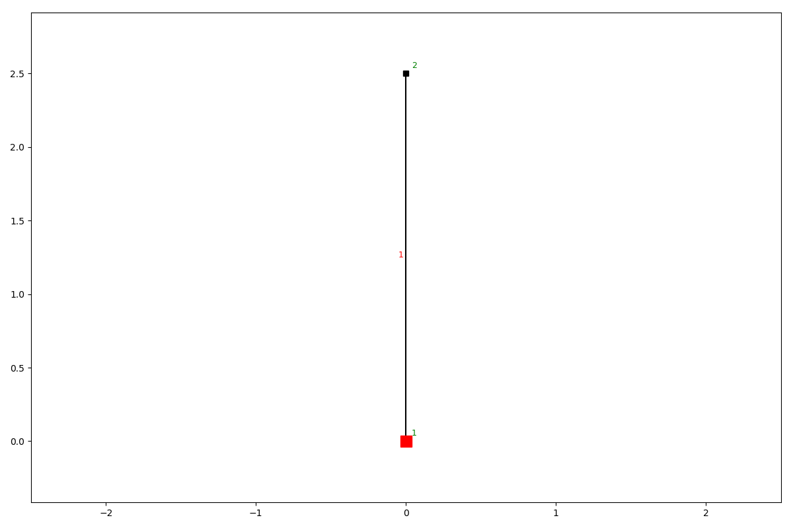
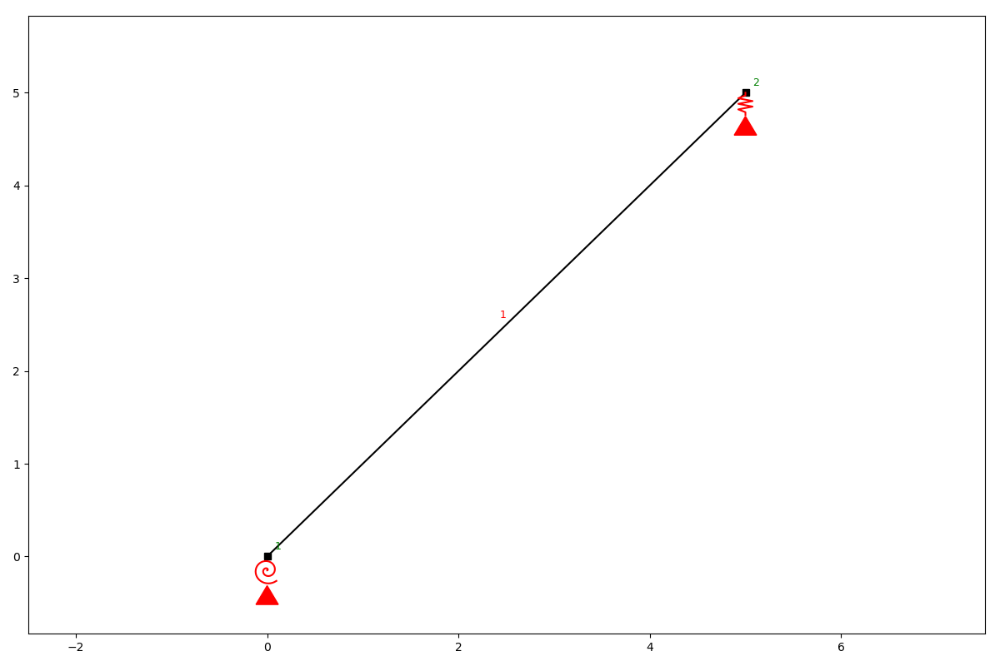

Supports
========

The following kinds of support conditions are possible.

* hinged (the node is able to rotate, but cannot translate)
* roll (the node is able to rotate and translation is allowed in one direction)
* fixed (the node cannot translate and not rotate)
* spring (translation and rotation are allowed but only with a linearly increasing resistance)

add_support_hinged
##################

.. automethod:: anastruct.fem.system.SystemElements.add_support_hinged

Example
.......

.. code-block:: python

    ss.add_element(location=[5, 1])
    ss.add_support_hinged(node_id=[1, 2])
    ss.show_structure()

add_support_roll
################

.. automethod:: anastruct.fem.system.SystemElements.add_support_roll

Example
.......

.. code-block:: python

    ss.add_element(location=[5, 5])
    ss.add_support_roll(node_id=2, direction=1)
    ss.add_support_roll(node_id=1, direction=2)
    ss.show_structure()

add_support_fixed
#################

.. automethod:: anastruct.fem.system.SystemElements.add_support_fixed

Example
.......

.. code-block:: python

    ss.add_element(location=[0, 2.5])
    ss.add_support_fixed(node_id=1)
    ss.show_structure()

add_support_spring
##################

Example
.......

.. code-block:: python

    ss.add_element(location=[5, 5])
    ss.add_support_spring(node_id=1, translation=3, k=1000)
    ss.add_support_spring(node_id=-1, translation=2, k=1000)
    ss.show_structure()

.. automethod:: anastruct.fem.system.SystemElements.add_support_spring

Imposed displacements
#####################

A support settlement or an imposed rotation is prescribed to a degree of freedom that is restrained by a support.
Impose the displacements before the first :meth:`~anastruct.fem.system.SystemElements.solve`. In a
:class:`.LoadCombination` use :meth:`.LoadCase.imposed_displacement`, so that the settlement belongs to one load case.

.. automethod:: anastruct.fem.system.SystemElements.imposed_displacement

Like a load :code:`Fy`, a positive :code:`uy` is in the +y direction (upwards), so a settlement is negative; the
rotation :code:`phi_z` is positive like a moment load :code:`Tz`, and is reported with the opposite sign by
:code:`get_node_displacements`.

Example
.......

.. code-block:: python

    ss = SystemElements(EA=1e6, EI=1e4)
    ss.add_element([[0, 0], [10, 0]])
    ss.add_support_fixed(1)
    ss.add_support_roll(2)
    ss.imposed_displacement(node_id=2, uy=-0.02)  # 20 mm downwards (uy is positive upwards, like Fy)
    ss.solve()

Inclined roller supports
########################

A roll support with an :code:`angle` is inclined: the support is free in the direction of the angle (relative to the
global x-axis) and restrains the translation normal to it. Loads can be placed at the node of an inclined roller. The
reaction of the support is normal to the free direction.

An imposed displacement is possible only in a direction that a support restrains: in a free direction the node moves as
the structure requires, so its displacement is a result and can not be a condition. That is why a displacement can not
be imposed in the free direction of a roller, for the rotation of a hinged support, at a spring support (which yields),
or at a node without a support. An inclined roller restrains only the translation normal to its free direction, while
the imposed :code:`ux` and :code:`uy` are in the global directions and have a component along the free direction, so
imposing them on an inclined roller is not possible either. In all these cases :code:`solve` (or
:code:`imposed_displacement` for an inclined roller) raises a :code:`FEMException` whose message explains which support
restrains what.

Changing the model after a calculation
######################################

Supports, elements and internal hinges can be added after a calculation (and :code:`insert_node` and
:code:`remove_element` can be used). The solution is then reset, so that the next :code:`solve` processes the changed
model.
